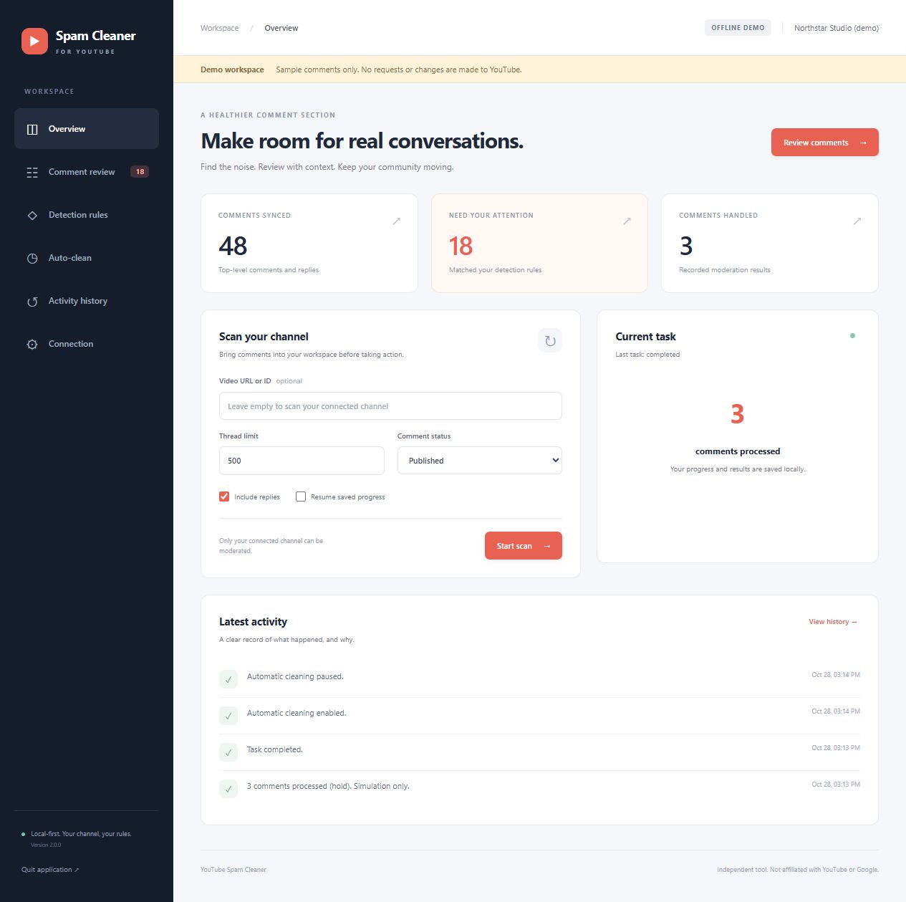
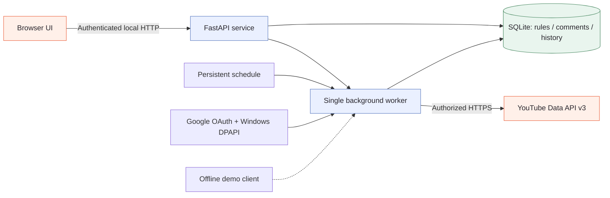

# YouTube Spam Cleaner

A local web app for reviewing and moderating spam on **your own YouTube channel**. Download the Windows app and work in your browser. No Python, Node.js, or compiler is required.



## Download and run

1. Download **YouTubeSpamCleaner-2.0.0-windows-x64.zip** from the [latest release](https://github.com/RayLo0204/YouTubeSpamCleaner/releases/latest).
2. Extract the ZIP, then double-click **YouTubeSpamCleaner.exe**. Your default browser opens the local app.
3. Try **Demo.cmd** for an offline sample channel, or connect your channel using the Google setup below.

The Windows x64 download includes the runtime and web assets. It is unsigned; checksums are included. Demo mode uses a separate database and never contacts Google or changes real comments.

## Connect your channel

Google credentials are required for real use. No shared API key or developer account is embedded.

1. Create or select a project in [Google Cloud Console](https://console.cloud.google.com/).
2. Enable **YouTube Data API v3**.
3. Configure **Google Auth Platform / OAuth consent**. If the app is in Testing, add your Google account as a test user.
4. Create an **OAuth client ID**, choosing **Desktop app**, and download its JSON credentials.
5. Open **Connection** in the cleaner, import the JSON, and choose **Connect with Google**.
6. Complete consent in your system browser. Return to the cleaner and verify the displayed channel before scanning.

The scope is `https://www.googleapis.com/auth/youtube.force-ssl`, which permits reading and moderating comments. Authorization uses the installed-app flow with PKCE and a temporary loopback callback. Google may restrict testing, require verification, or expire testing-mode refresh tokens depending on your consent configuration. Follow Google's consent requirements and reconnect when requested. See [Google's desktop OAuth guide](https://developers.google.com/identity/protocols/oauth2/native-app).

## Review and clean

1. In **Rules**, add words, phrases, regular expressions, or trusted author channel IDs. Import an existing UTF-8 keyword file with one keyword per line.
2. On **Overview**, scan the channel or paste an owned video's URL. Choose published or held comments, the thread limit, and whether to include replies.
3. Open **Comment review**, inspect matches and rule explanations, and select comments.
4. Choose an action and confirm. Track progress and results in **History**.
5. Optionally enable **Auto-clean** after reviewing your rules. It runs while the app and computer remain running. Failures pause automation.

| Action | Effect |
|---|---|
| Hold for review | Moves selected comments to the review queue. |
| Reject | Hides selected comments. Rejecting a top-level comment also hides its replies. |
| Reject + ban author | Rejects selected comments and asks YouTube to reject additional comments by those authors. |
| Publish | Publishes comments currently held for review. |

Actions use [`comments.setModerationStatus`](https://developers.google.com/youtube/data/reference/rest/v3/comments/setModerationStatus) in batches of up to 50 IDs. The app does not offer permanent deletion. Rejected comments cannot be republished through this API. Author bans have broader effects than the selected rows.

A timeout can occur after YouTube accepts a write. Such actions are marked **Unknown** and never automatically repeated. Check YouTube Studio, then reconcile the action in History. A confirmed API response means YouTube accepted the request; the app does not independently verify the public page afterward.

## Matching, pagination, and limits

- Matching normalizes Unicode width, removes invisible format characters, folds case, and normalizes whitespace. Contains rules match substrings; phrase rules require word boundaries. Regex matching has a time limit. Exact author channel ID allowlists override matching rules.
- Scans paginate through threads and replies. The default is 500 top-level threads; the range is 1–5,000 per run.
- Each client session permits at most 500 read requests. Each thread permits up to 10 reply pages per scan. Partial scans retain cursors; **Resume** continues them. Starting a fresh scan checks newest threads again.
- Replies are fetched separately, including replies omitted from thread previews. API visibility and moderation-state restrictions still apply. Results are not a snapshot of every historic or deleted comment.
- Automatic runs scan their configured target/status, then process up to 1,000 locally flagged, unhandled comments in that scope. Edited comments can be matched again. Review rules for false positives before enabling automation.
- Quota belongs to your Google Cloud project. Read requests generally cost 1 unit; each moderation request costs 50 units, even for fewer than 50 comments. See the official [quota calculator](https://developers.google.com/youtube/v3/determine_quota_cost).
- Ownership is checked before scanning a specific video and before moderation. This tool moderates your connected channel.

## Local data and lifecycle

| Item | Location / behavior |
|---|---|
| Normal data | `%LOCALAPPDATA%\YouTubeSpamCleaner\data` |
| Offline demo data | `%LOCALAPPDATA%\YouTubeSpamCleaner\demo` |
| Rules, results, schedule, history | `cleaner.db` (SQLite) |
| Google client and token | `client.vault`, `token.vault`; Windows DPAPI protection for the current Windows account |
| Diagnostic log | `application.log`, size-limited rotation |
| Runtime session | `session.json`, removed on normal shutdown |

Closing a browser tab leaves the service running. Launch the EXE again to reopen it. Use **Quit application** in the sidebar to stop it. Scheduled work does not run during sleep, shutdown, or after quitting. Cancellation stops between requests; an in-flight request may finish. Interrupted writes become Unknown on restart.

The server binds only to `127.0.0.1` on an available port. API requests require a per-launch session capability. The UI has no CDN or analytics. Google credentials and comments stay local except for requests to Google/YouTube. Keep the data directory private. Disconnect removes the token and pauses automation; revoke consent separately in your Google account if needed. Non-Windows source installations use restricted local files rather than DPAPI encryption.

Version 2 replaces the earlier PyQt app. Existing `spam_keywords.txt` files can be imported. Old login sessions and GUI settings are not automatically migrated. The original source remains in Git history.

## Architecture



Manual and scheduled jobs share one worker to prevent overlap. Each job owns its HTTP session. SQLite persists progress and an action journal so crashes do not silently convert uncertain writes into successful ones.

| Source | Responsibility |
|---|---|
| `cleaner/launcher.py` | Local server, browser launch, single-instance lifecycle |
| `cleaner/web.py`, `cleaner/static/` | API, session access, browser interface |
| `cleaner/engine.py` | Scanning, batches, cancellation, scheduling |
| `cleaner/youtube.py` | REST requests and error classification |
| `cleaner/auth.py` | OAuth, refresh, credential protection |
| `cleaner/store.py`, `cleaner/rules.py` | Persistence and matching |
| `cleaner/demo.py` | Offline simulated channel |

## Development

Downloaded app users do not need these steps. For source development, use Python 3.12:

```powershell
py -3.12 -m venv .venv
.venv\Scripts\python -m pip install -r requirements-dev.txt
.venv\Scripts\python launcher.py --demo
.venv\Scripts\python -m pytest -q
```

Build and exercise the Windows x64 release on Windows:

```powershell
.venv\Scripts\python scripts/build_windows.py
.venv\Scripts\python scripts/smoke_executable.py dist/YouTubeSpamCleaner.exe --mode demo
.venv\Scripts\python scripts/smoke_executable.py dist/YouTubeSpamCleaner.exe --mode normal
```

Runtime dependencies: FastAPI, Uvicorn, google-auth-oauthlib, Requests, and regex. PyInstaller bundles the runtime. Exact build dependencies are recorded in `requirements-lock.txt`. See [VERIFICATION.md](VERIFICATION.md) for the actual checks and live-account limitations.
